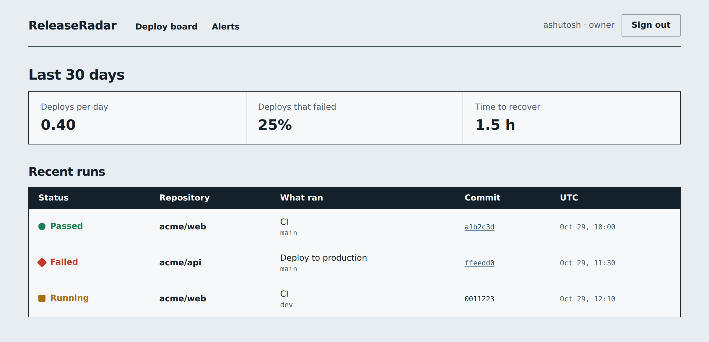
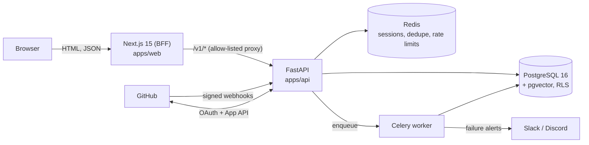

<div align="center">

# ReleaseRadar

**Every deploy, one board.**
Build and deploy status across all your GitHub repositories, DORA metrics, and Slack/Discord alerts the moment something fails.




<sub>Screenshot uses demo data.</sub>

</div>

---

## Contents

- [What it does](#what-it-does)
- [Architecture](#architecture)
- [Tech stack](#tech-stack)
- [Repository layout](#repository-layout)
- [Getting started](#getting-started)
- [Configuration](#configuration)
- [Testing and CI](#testing-and-ci)
- [Deployment](#deployment)
- [Security model](#security-model)
- [Troubleshooting](#troubleshooting)
- [Status and known limits](#status-and-known-limits)
- [Contributing and security reports](#contributing-and-security-reports)
- [License](#license)

## What it does

- **One deploy board.** Recent builds and deployments from every repository the GitHub App is installed on, with status shown as colour, shape *and* text so it stays readable for everyone.
- **DORA metrics.** Deployment frequency, change failure rate and time to recover over a 30-day window, computed from real deployment events.
- **Failure alerts.** Add a Slack or Discord webhook and get a message when a build or deploy *transitions into* failure (not on every retry).
- **GitHub sign-in, no passwords.** Authentication is GitHub App OAuth with PKCE. Roles (`owner`, `admin`, `viewer`) gate what each person can change.
- **Multi-tenant by design.** Every row belongs to an organisation and is isolated with Postgres row-level security.

## Architecture

The browser only ever talks to **one origin**: the Next.js app. It acts as a backend-for-frontend (BFF) and forwards `/api/v1/*` to FastAPI, which is why the API needs no CORS and the session cookie can be a host-only `__Host-` cookie.



**Request flow for a page view:** the dashboard is a server component, so Next.js calls the API *server-to-server* with the user's session cookie, validates the response with Zod, and renders HTML. Nothing sensitive is ever readable by browser JavaScript.

## Tech stack

| Layer | Technology |
|---|---|
| Web | Next.js 15 (App Router, standalone output), React 19, TypeScript (strict), Tailwind CSS 3, Zod, class-variance-authority |
| API | FastAPI, Pydantic v2, SQLAlchemy 2 (async) + asyncpg, Alembic, structlog, PyJWT |
| Workers | Celery (JSON-only serialisation) on Redis |
| Data | PostgreSQL 16 with pgvector and row-level security, Redis 7 |
| Quality | pytest, Ruff, ESLint, `tsc`, pre-commit, Dependabot, GitHub Actions |
| Deploy | Docker images for both apps, Render blueprint for API and worker |

## Repository layout

```
apps/
  web/            Next.js app. The only browser-facing origin.
    src/app/        Routes, layouts, error and 404 pages
    src/features/   Dashboard board, alert manager, auth controls
    src/lib/        Server API client, Zod schemas, CSP builder, sanitiser
  api/            FastAPI service, Celery worker, Alembic migrations
    app/api/        HTTP routes (auth, builds, metrics, alerts)
    app/ingress/    GitHub webhook receiver and signature verification
    app/services/   DORA maths, event ingestion, alert senders, SSRF guard
    app/ai/         Guardrails, retrieval and a fixed read-only tool registry
    tests/          unit, integration and security suites
infra/            Local Docker Compose and the Render blueprint
docs/             Threat model (control -> code -> test) and screenshots
.github/          CI, security scanning, Dependabot, CODEOWNERS
```

## Getting started

### Prerequisites

- Node.js **22** and npm
- Python **3.12**
- Docker (for local PostgreSQL and Redis)
- A GitHub account that can create a **GitHub App**
- A way to expose your local API to GitHub for webhooks (for example a tunnel such as `cloudflared` or `ngrok`)

### 1. Start PostgreSQL and Redis

```bash
export POSTGRES_OWNER_PASSWORD='choose-a-password'
export REDIS_PASSWORD='choose-another-password'
docker compose -f infra/compose.dev.yml up -d
```

Everything binds to `127.0.0.1`. Credentials come from your shell, never from the compose file.

### 2. Create a GitHub App

In GitHub: **Settings > Developer settings > GitHub Apps > New GitHub App**.

| Setting | Value |
|---|---|
| Repository permissions | Actions: read, Metadata: read, Deployments: read |
| Organization permissions | Members: read |
| Subscribe to events | Workflow run, Deployment status |
| Callback URL | `http://localhost:3000/api/v1/auth/github/callback` |
| Webhook URL | `<your public API URL>/webhooks/github` |
| Webhook secret | 32+ random characters (`openssl rand -hex 32`) |

Generate a client secret and a private key, and note the App ID and Client ID.

### 3. Configure and start the API

```bash
cd apps/api
cp .env.example .env          # then fill in the blanks
python -m venv .venv && source .venv/bin/activate
pip install -r requirements-dev.txt
python -m app.core.crypto     # prints a new encryption key for ENCRYPTION_KEYS
```

Set `ENCRYPTION_KEYS=key1:<that key>` in `apps/api/.env`.

Run the migrations as the **owner** role. Alembic reads this variable from the real environment, not from `.env`:

```bash
export MIGRATION_DATABASE_URL='postgresql+asyncpg://releaseradar_owner:<owner-password>@localhost:5432/releaseradar'
alembic upgrade head
```

The migration creates a least-privilege runtime role, `releaseradar_app`, **without a password**. Give it one and use it in `DATABASE_URL`, so the app can never bypass row-level security:

```bash
docker compose -f ../../infra/compose.dev.yml exec postgres \
  psql -U releaseradar_owner -d releaseradar -c "ALTER ROLE releaseradar_app PASSWORD '<app-password>';"
```

Start the API and the worker (two terminals):

```bash
uvicorn app.main:create_app --factory --reload              # http://localhost:8000
celery -A app.workers.celery_app:celery_app worker -l info
```

Health check: `curl http://localhost:8000/healthz` returns `{"status":"ok"}`.

### 4. Start the web app

```bash
cd apps/web
cp .env.example .env
npm ci
npm run dev                    # http://localhost:3000
```

Open <http://localhost:3000> and choose **Sign in with GitHub**.

> **Use Chrome or Firefox for local development.** The session cookie is a `__Host-` cookie, which requires `Secure`. Chrome and Firefox accept it on `http://localhost`; Safari does not.

## Configuration

### Web (`apps/web/.env`)

Server-only. Nothing is prefixed `NEXT_PUBLIC_` on purpose, so the browser never sees these values. They are validated at startup, and a bad value fails fast.

| Variable | Example | Purpose |
|---|---|---|
| `API_ORIGIN` | `http://localhost:8000` | Where Next.js reaches the FastAPI service. No trailing slash. **Must be `https://` in production.** |
| `WEB_ORIGIN` | `http://localhost:3000` | Public URL of the web app. No trailing slash. |
| `CSP_REPORT_ONLY` | `0` | Set to `1` to send the Content-Security-Policy as report-only while rolling out a change. |

### API (`apps/api/.env`)

| Variable | Purpose |
|---|---|
| `ENV` | `dev`, `test` or `prod`. `prod` enforces TLS and strict-secret checks at boot. |
| `DATABASE_URL` | Runtime connection as the **non-owner** `releaseradar_app` role. |
| `MIGRATION_DATABASE_URL` | Owner connection used only by Alembic. |
| `REDIS_URL` | Redis connection. Must be `rediss://` (TLS) in production. |
| `WEB_ORIGIN` | Public URL of the web app (used for OAuth redirects and CSRF origin checks). |
| `GITHUB_APP_ID`, `GITHUB_CLIENT_ID`, `GITHUB_CLIENT_SECRET`, `GITHUB_APP_PRIVATE_KEY` | Credentials of your GitHub App. |
| `GITHUB_WEBHOOK_SECRET` | 32+ random characters, same value as in the GitHub App. |
| `ENCRYPTION_KEYS`, `ENCRYPTION_CURRENT_KEY_ID` | Envelope-encryption keys (`key1:<key>`) and which one encrypts new data. Supports rotation. |
| `DOCS_ENABLED` | `true` exposes `/docs` locally. Must be `false` in production. |

Real values belong in your secret store and never in git. `.env` files are git-ignored.

## Testing and CI

```bash
# API: unit, integration and security suites
cd apps/api && pytest -q && ruff check .

# Web: types, lint, production build
cd apps/web && npm run typecheck && npm run lint && npm run build
```

The security suite covers forged webhook signatures, replay, cross-tenant access (IDOR), CSRF, SSRF and crypto.

GitHub Actions runs the API job (Ruff + pytest) and the web job (typecheck, lint, build) on every push and pull request, plus a separate security workflow. Dependabot keeps pip, npm, Docker and Actions dependencies current. A `.pre-commit-config.yaml` is included: `pre-commit install`.

> A production build refuses to start unless `API_ORIGIN` is `https://`. To build locally, pass explicit values:
> `API_ORIGIN=https://api.example.com WEB_ORIGIN=https://app.example.com npm run build`

## Deployment

**API and worker** deploy to [Render](https://render.com) from `infra/render.yaml` (two Docker services: `releaseradar-api` with a `/healthz` check, and `releaseradar-worker`). Every secret is declared `sync: false`, so you enter the values in the Render dashboard and none are committed. Set `FORWARDED_ALLOW_IPS` to your real proxy addresses, never `*`.

**Web** ships as a standalone Next.js Docker image (`apps/web/Dockerfile`, runs as a non-root user), and also fits any host that supports Next.js server rendering and middleware, such as Vercel. Provide these at runtime:

```
API_ORIGIN=https://<your-api-host>
WEB_ORIGIN=https://<your-web-host>
```

After deploying, update the GitHub App so its **callback URL** is `https://<web-host>/api/v1/auth/github/callback` and its **webhook URL** is `https://<api-host>/webhooks/github`.

**Production checklist**

- [ ] `ENV=prod`, `DOCS_ENABLED=false`
- [ ] `DATABASE_URL` uses the `releaseradar_app` role with a strong, out-of-band password
- [ ] Postgres and Redis require TLS (`ssl=require`, `rediss://`)
- [ ] `FORWARDED_ALLOW_IPS` lists only your proxy
- [ ] Webhook secret is 32+ random characters
- [ ] Web and API are deployed from the same commit

## Security model

Security is a first-class feature here, not an afterthought. Highlights:

- **Sessions:** opaque IDs, stored hashed in Redis, `HttpOnly` + `Secure` + `SameSite` cookie, fresh ID on every login, idle and absolute timeouts.
- **CSRF and login CSRF:** per-session token plus Origin check; OAuth `state` mirrored in a cookie and Redis; PKCE (S256); fixed redirect URI, no open redirects.
- **Webhooks:** HMAC-SHA256 over the raw body with constant-time comparison, delivery-ID replay protection, body-size caps.
- **Tenant isolation:** the org comes from the session only; Postgres row-level security with a non-owner runtime role.
- **Secrets at rest:** webhook URLs are encrypted with AES-256-GCM (per-row AAD, key rotation); only the last four characters are ever returned.
- **SSRF:** alert destinations are restricted to an exact Slack/Discord allow-list, https only, public-IP checks, no redirects, re-validated at send time.
- **Browser hardening:** strict nonce-based CSP (no `unsafe-inline`), HSTS, `X-Frame-Options: DENY`, no `dangerouslySetInnerHTML` (ESLint-enforced), every API response validated with Zod.
- **AI guardrails:** CI data is treated as untrusted, redacted, and the assistant gets a fixed **read-only** tool allow-list.

Every control is mapped to its code and its test in [`docs/threat-model.md`](docs/threat-model.md), including an honest list of residual risks.

## Troubleshooting

| Symptom | Likely cause and fix |
|---|---|
| Page says **"We can't reach the ReleaseRadar API"** | The web app is up but the API isn't answering. Start the API and check that `API_ORIGIN` in `apps/web/.env` points to it. |
| Page says **"The API sent data this app can't read"** | Web and API are on different versions. Redeploy both from the same commit. |
| Production build or start fails with `API_ORIGIN must be https in production` | Intentional safety check. Use an `https://` origin, or run `npm run dev` locally. |
| Sign-in loops back to the login page in Safari | `__Host-` cookies are not accepted on `http://localhost` in Safari. Use Chrome or Firefox. |
| `GitHub sign-in didn't complete` | Callback URL in the GitHub App must exactly match `<WEB_ORIGIN>/api/v1/auth/github/callback`. |
| `alembic upgrade head` says `MIGRATION_DATABASE_URL is required` | Export the variable in your shell. Alembic does not read `.env`. |
| API refuses to boot in prod | Fail-fast config checks: read the message (TLS, `https` origins, secret strength, `DOCS_ENABLED`). |
| Webhooks never arrive locally | GitHub can't reach `localhost`. Use a tunnel and put its URL in the GitHub App's webhook setting. |

## Status and known limits

This is a working foundation with a deliberately small surface. Not built yet:

- Lead time for changes (needs commit timestamps) is not part of the DORA output
- Syncing historical runs through GitHub App installation tokens
- Organisation invitations (first org admin to sign in links the installation)
- LangGraph wiring and model calls (guardrails and tools are in place)
- Backup/restore runbooks and WAF/DDoS protection

See [`docs/threat-model.md`](docs/threat-model.md) for the full list of residual risks.

## Contributing and security reports

Issues and pull requests are welcome. Before opening a PR, run the checks in [Testing and CI](#testing-and-ci). Changes under `apps/api/app/ai/` and other sensitive paths are covered by [`CODEOWNERS`](.github/CODEOWNERS) and need review.

**Found a vulnerability?** Please do not open a public issue. Report it privately through GitHub Security Advisories, as described in [`SECURITY.md`](SECURITY.md). Never include real tokens, webhook URLs or customer data in a report.

## License

No license has been chosen yet, so all rights are reserved by default. Add a `LICENSE` file (for example MIT or Apache-2.0) to let others use the code.
